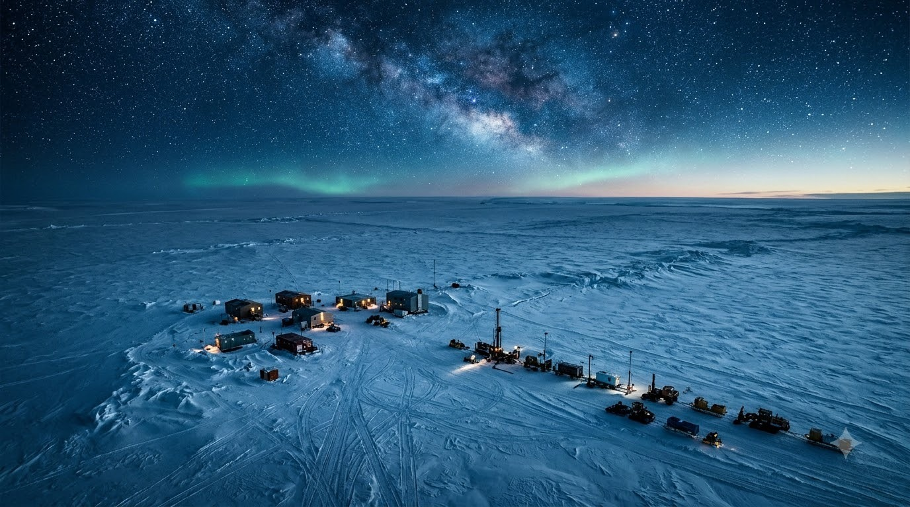
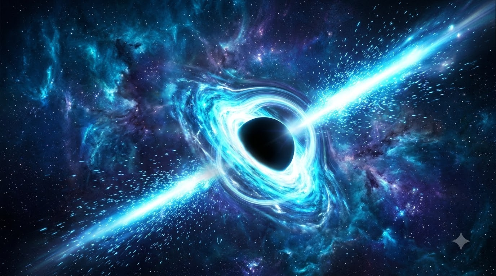
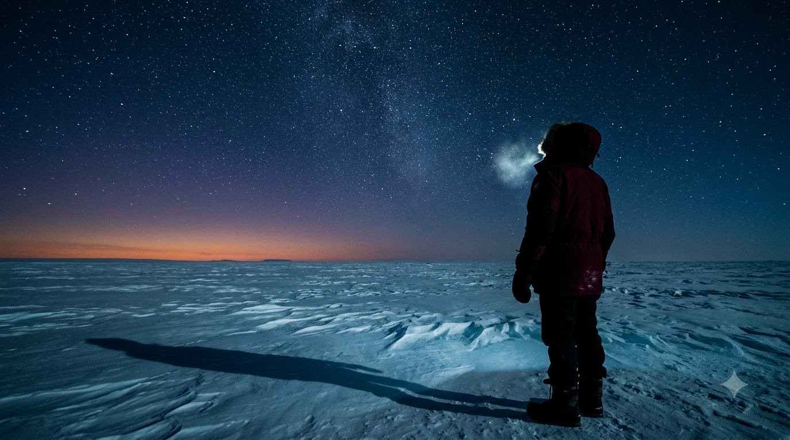
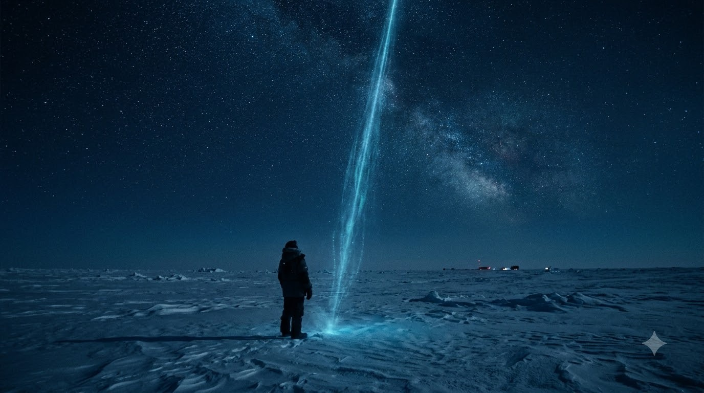

# NOBEL PRIZE IN PHYSICS · 2026

## A chilling particle tracker at the South Pole

    

The story of turning a cubic kilometre of Antarctic ice into a telescope capable of detecting particles from the distant universe.

Francis Halzen, a Belgian-American physicist who has worked in both theoretical and experimental particle physics, discovered that ice particles at the South Pole could be used to track an elementary, subatomic particle known as neutrino.

In 2004, he began construction of the IceCube project. After seven years of construction, IceCube became fully operational in 2011. Using IceCube, researchers can capture neutrinos from extremely energy-rich processes in the distant universe.

Halzen believed that the vast, transparent ice beneath Antarctica could help scientists detect subatomic particles, so microscopic that there are very few methods of actually tracking them, and trace them back to some events in the universe, that cause huge release of energy.

In October 2026, Halzen was awarded the Nobel Prize in Physics for his work and contributions to IceCube and the discovery of high-energy neutrinos that are caused in different parts of the universe.

## Interstellar particles and their origin

    

Neutrinos are elementary particles that interact via the weak interaction and gravity. The rest mass of the neutrino is much smaller than that of the other known elementary particles making it extremely hard for scientists to detect them or observe them in the known universe.

Unlike light, which can be absorbed or scattered by matter, neutrinos can travel through enormous amounts of material without interacting. Even the Earth, which is made up of a large cluster of atoms is largely transparent to them, because atoms interact with foreign particles via their electromagnetic properties and the neutrinos having no charge make them an, "invisible particle".

This unusual property makes neutrinos valuable messengers from space.

When powerful cosmic environments produce neutrinos, those particles travel a long distance without getting displaced or absorbed. They are often carrying information about the conditions in which they were created.

Traditional telescopes observe electromagnetic radiation, from visible light to X-rays and gamma rays. Neutrino observatories, however, offer a fundamentally different way of observation.

## The Polar Particle Detector

    

One of the key components of Dr. Halzen's work was the Ice Cube research Observatory.

Instead of building an enormous artificial detector, his team used the naturally occurring Antarctic ice as their detection medium.

The observatory contains 5,160 digital optical modules arranged along 86 vertical strings, embedded approximately 1,450 to 2,450 metres beneath the surface. Together, they instrument a volume of roughly one cubic kilometre.

These sensors do not use traditional detection systems to photograph the particle. Instead, they detect the faint flashes of light that can occur when a neutrino interacts with matter.

When a neutrino collides with an atomic nucleus, it may produce a charged particle that travels through the surrounding ice. If that particle moves faster than light travels through the ice, it emits a faint blue glow known as Cherenkov radiation.

The optical sensors catch the photons produced in this process. And by measuring when the light arrives and which sensors receive it, scientists reconstruct the event and estimate the original neutrino's direction and energy.

If there is a long trail of light that can be a strong proof for the path of a muon, while other observations may lead to more compact showers of particles.

In this way, the ice becomes a gigantic particle detector, transforming tiny flashes of light into information about events taking place billions of light-years away.

## Why the Nobel Prize matters

    

On October 6, 2026, Francis Halzen received the Nobel Prize in Physics for his contributions to the Ice Cube Neutrino Observatory and the discovery of high-energy neutrinos of astrophysical origin.

His achievement was not simply Ice Cube facility but a culmination of his tremendous contributions towards modern physics, that help us unravel the mysteries of the vast Universe.

Although the Nobel Prize recognises Halzen's individual contribution, Ice Cube itself is the product of decades of work by a large international scientific community.

The observatory has transformed neutrinos from elusive particles into powerful tools for investigating the cosmos.

